<p align="center">
  
</p>

<p align="center">
  
</p>

<p align="center">
  <strong>An animated dragon living in your GitHub README that breathes, blinks, and evolves from your real GitHub coding activity.</strong>
</p>

<p align="center">
  <a href="#-quick-setup-2-minutes"></a>
  <a href="#-evolution-tiers"></a>
  <a href="#-color-palettes"></a>
  <a href="SETUP.md"></a>
  <a href="LICENSE"></a>
</p>

---

## 🐉 Meet Drago

**Drago is not a static badge or flat image.** 

He is an animated draconic companion designed in a cel-shaded action-adventure cartoon style who lives directly on your GitHub profile:

- 🫁 **Deep breathing motion** with rhythmic chest and wing flexion
- 👁️ **Natural eye blinking** tracking visitors across your profile
- 🐾 **Sinuous tail sway** and ground-gripping talons
- 🔥 **Blazing energy aura** that ignites when you are on an active contribution streak
- 🧬 **Physical anatomical evolution** growing from a gentle Magma Egg into a mythical deity as you commit code

Works out of the box on GitHub with **zero JavaScript or client dependencies**.

---

## ⚡ Quick Setup (2 Minutes)

Add Drago to your GitHub Profile README in two simple steps:

### Option A: The Easy Fork Way (Recommended)

1. **Fork this repository** to your GitHub account (name it `drago`).
2. **Enable GitHub Actions**:
   - In your forked repo, go to **Settings** $\rightarrow$ **Actions** $\rightarrow$ **General**.
   - Under **Workflow permissions**, choose **Read and write permissions** and click **Save**.
   - Go to the **Actions** tab and click **I understand my workflows, go ahead and enable them**.
3. **Embed in your Profile README** (`<username>/<username>`):
   Paste this snippet into your profile `README.md` (replace `YOUR_USERNAME` with your actual GitHub username, e.g. `Deepak-Kambala`):

```markdown
<p align="center">
  
  <br>
  
</p>
```

> [!TIP]
> **Example for `@Deepak-Kambala`:**
> ```markdown
> <p align="center">
>   
>   <br>
>   
> </p>
> ```

That's it! GitHub Actions automatically runs daily at midnight UTC to evaluate your commits, PRs, and streaks, continuously evolving your dragon.

---

### Option B: Directly Inside Your Profile Repository

If you prefer keeping everything in your `<username>/<username>` profile repository:

1. Copy the `drago/`, `.github/`, and `drago.config.json` folders into your profile repository.
2. In your profile repo settings, ensure **Read and write permissions** are enabled for Actions (**Settings $\rightarrow$ Actions $\rightarrow$ General $\rightarrow$ Workflow permissions**).
3. Add this snippet to your `README.md`:

```markdown
<p align="center">
  
  <br>
  
</p>
```

---

## 🏆 Evolution Tiers

Drago progresses through **13 distinct evolutionary forms** based on your GitHub activity:

| Level | Stage | XP Threshold | Distinct Traits | Animation Preview |
|:---:|:---|:---:|:---|:---:|
| **1** | **Egg** | `0 – 9` | Obsidian shell with golden magma veins & inner heartbeat pulse | 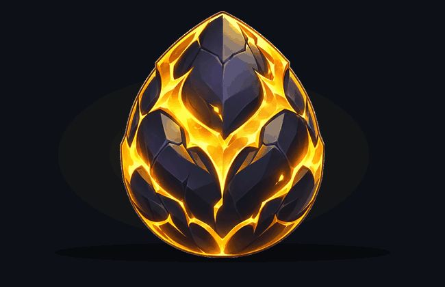 |
| **2** | **Hatchling** | `10 – 49` | Small compact wings, horn buds, eager amber eyes | 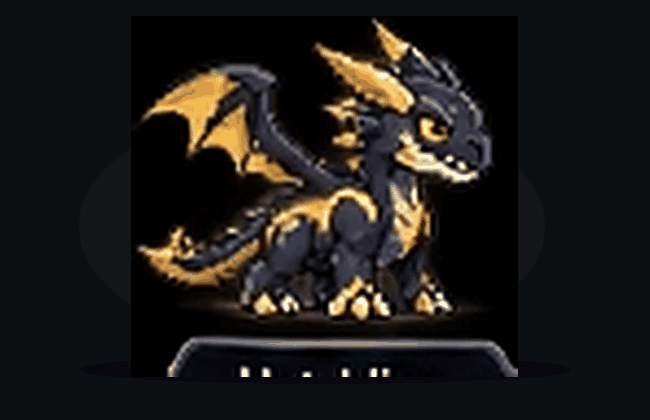 |
| **3** | **Youngling** | `50 – 149` | Curved horns, lengthened tail, sharp ivory talons | 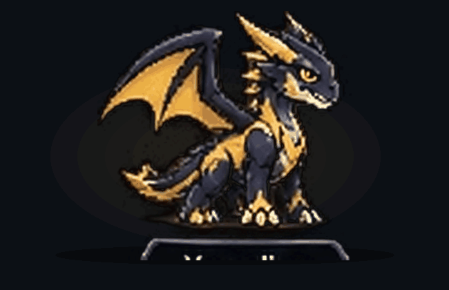 |
| **4** | **Juvenile** | `150 – 299` | Athletic build, dorsal spines, wider wingspan, glowing markings | 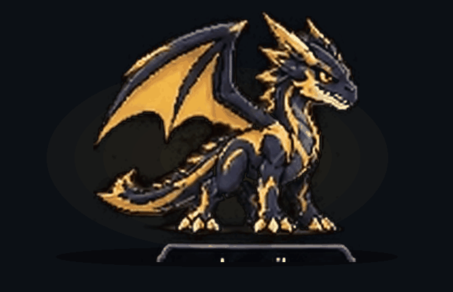 |
| **5** | **Adolescent** | `300 – 499` | Muscular limbs, sweeping battle horns, battle stance | 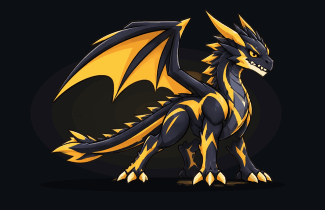 |
| **6** | **Adult** | `500 – 749` | Broad wingspan, heavy chest musculature, imposing silhouette | 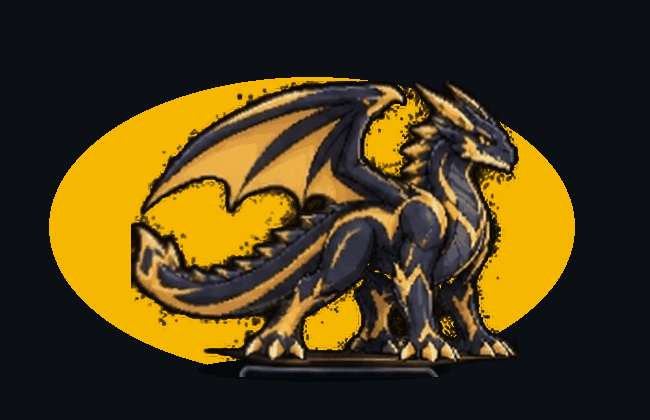 |
| **7** | **Mature** | `750 – 999` | Shoulder carapaces, reinforced tail blade, golden flank markings | 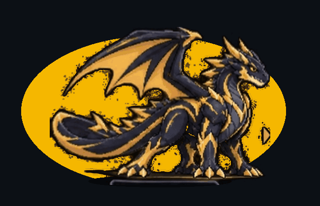 |
| **8** | **Ancient** | `1000 – 1499` | Multi-tiered monolithic horns, double dorsal spikes, dense armor | 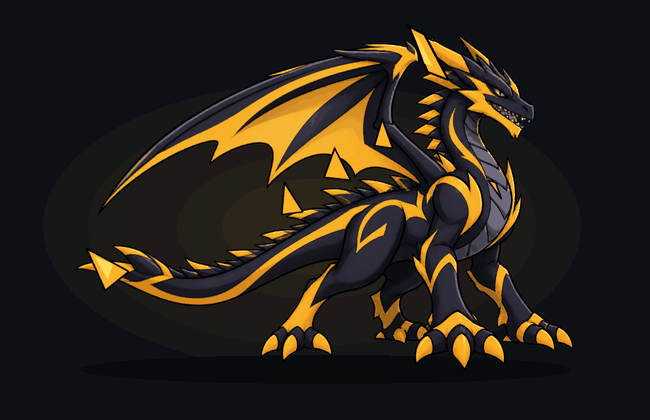 |
| **9** | **Warlord** | `1500 – 1999` | Massive razor wings, jagged spine armor, and radiating golden power | 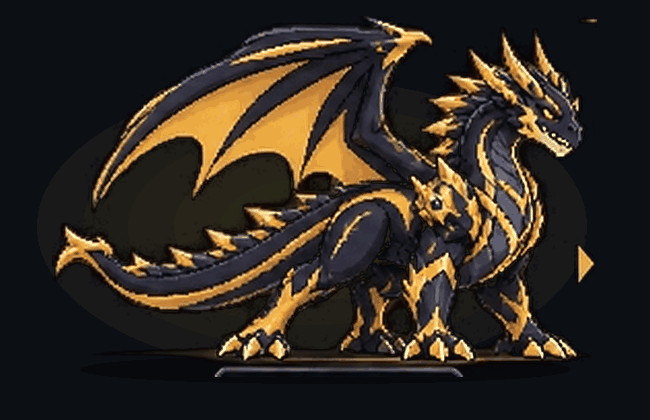 |
| **10** | **Elder** | `2000 – 2499` | Primordial horns, sharp dragon crests, and reinforced battle carapaces |  |
| **11** | **Dragon Lord** | `2500 – 2999` | Sovereign golden wings, shoulder star emblems, ground-tremoring talons |  |
| **12** | **Celestial Dragon** | `3000 – 3999` | Radiant cosmic wings, floating star crystals, and celestial energy flames |  |
| **13** | **Mythic Dragon** | `4000+` | Omnipotent form: blazing cosmic aura rings, orbiting energy crystals, divine flame | 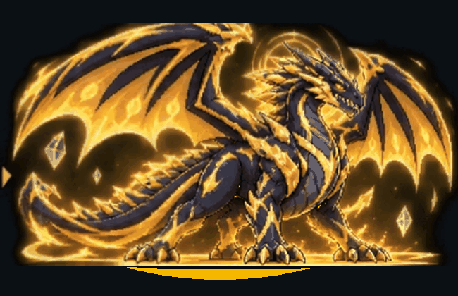 |

<p align="center">
  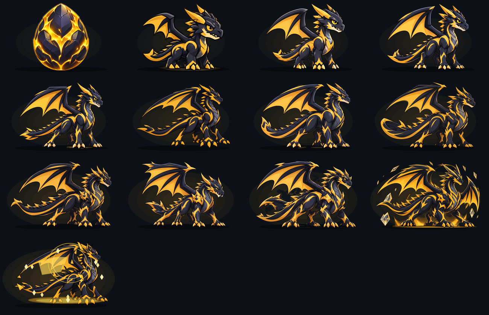
</p>

---

## 🧬 How Evolution Works

Drago's physical traits reflect your actual development habits:

| GitHub Metric | Draconic Impact |
| :--- | :--- |
| **Commits** | Increases overall body mass and muscular maturity |
| **Pull Requests** | Grows sweeping horns and dorsal armor plates |
| **Merged PRs** | Reinforces chest carapaces and shoulder guards |
| **Contribution Streak** | Ignites an active fiery energy aura |
| **Stars & Repositories** | Expands wingspan and elongates the bladed tail |

### Gentle Rolling Decay
- **Recent activity (0–7 days)** provides maximum energy and power.
- **Monthly contributions (8–30 days)** sustain body mass and wing structures.
- **Lifetime wisdom**: 30% of all contributions become permanent experience that never decays, so taking a break will never reset your dragon.

---

## 🎨 Color Palettes

Choose the skin that matches your profile's aesthetic:

- **Obsidian Gold** *(Default)*: Charcoal obsidian body `#1E1F24` with racing gold accents `#F5B700` and amber eyes.
- **Crimson Fury**: Deep scarlet charcoal `#2D0F14` with blazing crimson accents `#FF2A4D`.
- **Arctic Frost**: Glacial silver `#E2E9F2` with electric cyan energy `#00D2FF`.
- **Cyberpunk Neon**: Midnight synth `#14141E` with hyper turquoise `#00F5D4` and magenta spikes.
- **Toxic Emerald**: Bio-forest `#141D17` with radioactive green `#2BEE6C`.
- **Solar Flare**: Ember ash `#241812` with blazing solar orange flame `#FF7700`.

To change your palette, set `"palette_name"` in `drago.config.json` (e.g. `"palette_name": "crimson-fury"`).

---

## ⚙️ Advanced Configuration & Technical Docs

Looking for local CLI commands, custom point weights, testing suites, or architecture internals?

👉 Check out the **[Technical & Developer Setup Guide (SETUP.md)](SETUP.md)**.

---

## 📜 License

Distributed under the MIT License. See [LICENSE](LICENSE) for details.
