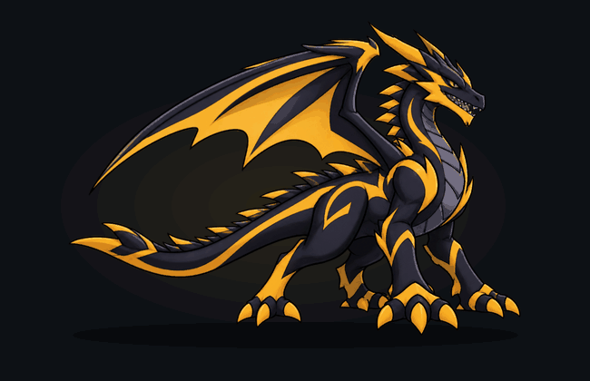
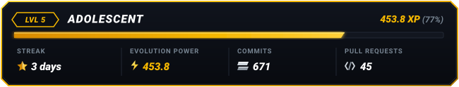
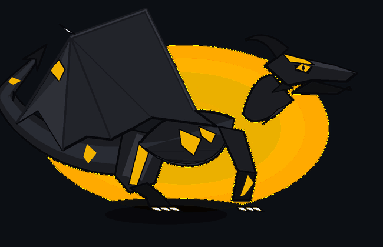
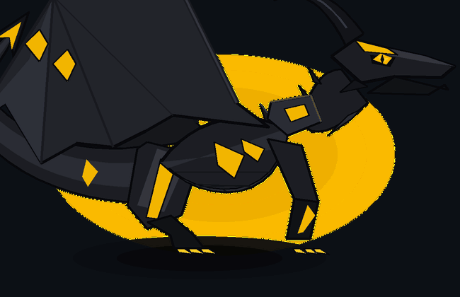
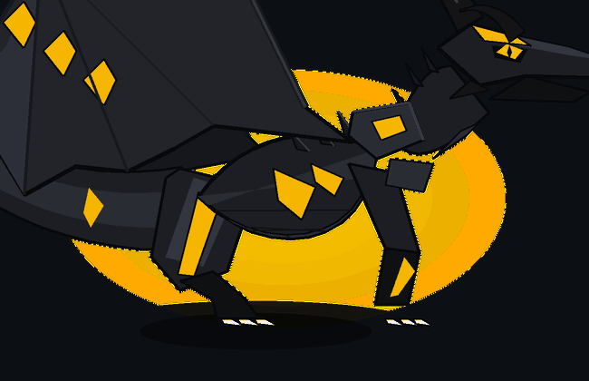
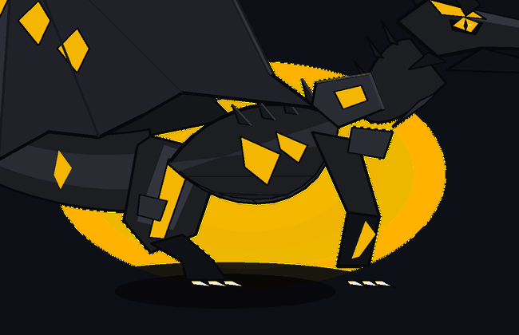
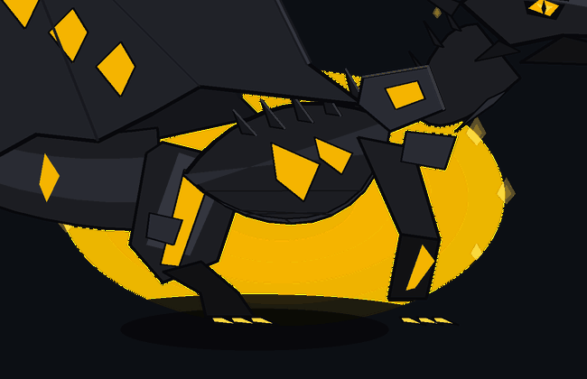
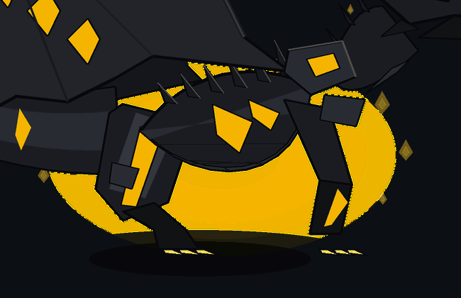
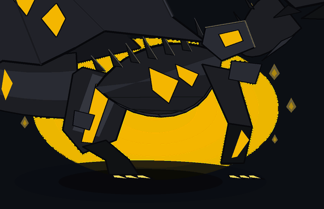

<p align="center">
  
</p>

<p align="center">
  
</p>

<p align="center">
  <strong>An animated cartoon dragon living inside your GitHub README, evolving from your real GitHub activity.</strong>
</p>

<p align="center">
  <a href="#-evolution-tiers"></a>
  <a href="#-color-palettes"></a>
  <a href="#-github-actions-automation"></a>
  <a href="#-quick-setup-3-steps"></a>
  <a href="LICENSE"></a>
</p>

---

## 🐉 The Drago Experience

**Drago is not a static dragon image.** 

He is a **living character** who resides inside your GitHub profile README. Day and night, visitors see him continuously moving:
- **Deep breathing motion** with rhythmic chest expansion and posture shifts
- **Natural eye blinking** with expressive amber slit pupils tracking visitors
- **Multi-segment sinuous tail sway** undulating organically
- **Wing flutter and flare** with leathery membrane flexion
- **Occasional roaring action bursts** exposing teeth and fanning wings
- **Radiant flame energy aura** that ignites when you are on an active contribution streak

No JavaScript required. No client-side interaction needed. **It works out of the box because GitHub renders animated assets natively.**

---

## 🧬 GitHub Activity → Draconic Evolution

Drago is **the same continuously animated dragon**, whose physical anatomy visibly develops as you code on GitHub:

```text
        [ Commits ]          ──►  Overall mass & muscular maturity
     [ Pull Requests ]       ──►  Elaborate sweeping horns & dorsal spines
      [ Merged PRs ]         ──►  Layered carapace armor plates
         [ Issues ]          ──►  Reinforced scales & rib armor
         [ Stars ]           ──►  Massive wingspan & membrane bio-markings
      [ Repositories ]       ──►  Tail length, fin blades & crests
   [ Contribution Streak ]   ──►  Active fire / spark energy aura
```

### Rolling Activity & Gradual Maturation

Drago doesn't lock you into a permanent level, nor does he suddenly shrink after a single inactive weekend:
- **Recent activity (0–7 days)** has the highest weight, keeping Drago energetic and fiery.
- **Monthly activity (8–30 days)** sustains body mass and wing development.
- **Older activity** decays gently, but **30% of your lifetime contributions form permanent draconic wisdom** that never vanishes.

---

## 🏆 Evolution Tiers

Drago progresses through **7 distinct evolutionary forms**, accumulating anatomical traits cumulatively:

| Level | Form | XP Threshold | Unlocked Anatomical Features | Preview |
|:---:|:---|:---:|:---|:---:|
| **1** | **Hatchling** | `0 – 49` | Small compact wings, horn buds, short tail with simple fin, eager eyes |  |
| **2** | **Young Drake** | `50 – 149` | Curved horns, lengthened tail, sharp ivory talons, dynamic racing stripes |  |
| **3** | **Adolescent Dragon** | `150 – 299` | Dorsal spines erupting along spine, wider wingspan, glowing markings |  |
| **4** | **Adult Wyrm** | `300 – 599` | Sweeping recurve horns, heavy shoulder pauldron armor, broader wing struts |  |
| **5** | **Mature Dreadwyrm** | `600 – 999` | Secondary brow horns, reinforced razor tail blade, chest carapace, flame embers |  |
| **6** | **Ancient Leviathan** | `1000 – 1999` | Monolithic swept horns, full spine spikes, layered leg guards, radiant gaze |  |
| **7** | **Legendary Titan** | `2000+` | Enormous wings, multi-tiered crown crest, impenetrable armor, cosmic energy aura |  |

---

## 🎨 Visual Language & Aesthetic

Drago is designed in an **action-adventure cartoon aesthetic** inspired by bold cel-shaded animated series:
- **Dark charcoal / obsidian body** with cel-shaded highlights and deep shadow zones
- **Bold 2D vector linework** with crisp cartoon ink contours
- **Vibrant racing bio-markings** along the flanks, thighs, wings, and snout
- **Aerodynamic predatory silhouette** with an angular skull, powerful jaw, and muscular legs
- **Anti-aliased supersampled rendering** (2x internal resolution with Lanczos filtering)

### Available Color Palettes

Switch Drago's skin anytime via `drago.config.json` or CLI flags:

- **Obsidian Gold** (Default): Jet charcoal body `#1E1F24`, brilliant racing gold accents `#F5B700`, amber eyes
- **Crimson Fury**: Deep scarlet charcoal `#2D0F14`, blazing crimson accents `#FF2A4D`, solar orange eyes
- **Arctic Frost**: Glacial white-silver `#E2E9F2`, neon cyan energy `#00D2FF`, electric blue eyes
- **Cyberpunk Neon**: Midnight synth `#14141E`, hyper turquoise `#00F5D4`, magenta claws and violet spikes
- **Toxic Emerald**: Dark bio-forest `#141D17`, radioactive neon green `#2BEE6C`, lime eyes
- **Solar Flare**: Ember ash `#241812`, blazing orange solar fire `#FF7700`, golden eyes

---

## 🚀 Quick Setup (3 Steps)

Add an animated Drago to your GitHub profile repository (`<username>/<username>`):

### Step 1: Copy Drago into your profile repo
Clone or copy the `drago/`, `.github/`, and `drago.config.json` files to your GitHub profile repository:

```bash
git clone https://github.com/your-username/drago.git
```

### Step 2: Configure your username
Edit `drago.config.json` with your GitHub username and favorite palette:

```json
{
  "username": "your-github-username",
  "palette_name": "obsidian-gold",
  "fps": 12,
  "frame_count": 24,
  "show_status_card": true
}
```

### Step 3: Embed in your README.md
Paste this markdown snippet into your profile `README.md`:

```markdown
<p align="center">
  
</p>
<p align="center">
  
</p>
```

Commit and push. The included **GitHub Actions workflow** (`.github/workflows/drago-update.yml`) runs automatically:
- Every night at midnight UTC (via cron)
- On every push/PR to your repository
- On manual trigger via the **Actions** tab

It calculates your activity, updates `assets/dragon.gif`, and commits the evolved asset back to your repo!

---

## 🛠️ CLI & Local Development

Install dependencies:

```bash
pip install -r requirements.txt
# or: pip install -e .
```

### Render a custom stage or activity
```bash
# Render Adult Wyrm (Stage 4) with Obsidian Gold palette
python3 -m drago.cli render --stage 4 --palette obsidian-gold

# Render with custom contribution numbers
python3 -m drago.cli render --commits 450 --prs 35 --merged-prs 28 --stars 95 --streak 14

# Render roaring action loop
python3 -m drago.cli render --stage 5 --action roar --output assets/dragon_roar.gif
```

### Generate all 7 preview GIFs
```bash
python3 -m drago.cli preview-all
```

### Test evolution simulator & rolling decay
```bash
python3 -m drago.cli simulate
```

### Fetch real GitHub activity and update
```bash
python3 -m drago.cli update --username your-github-username
```

### List available palettes
```bash
python3 -m drago.cli palettes
```

### Run tests
```bash
python3 -m unittest discover tests
```

---

## ⚙️ Configuration Reference (`drago.config.json`)

```json
{
  "username": "your-username",
  "palette_name": "obsidian-gold",
  "fps": 12,
  "frame_count": 24,
  "width": 650,
  "height": 420,
  "supersample": 2,
  "background": "github-dark",
  "show_status_card": true,
  "weights": {
    "commit": 1.0,
    "pull_request": 4.0,
    "merged_pr": 6.0,
    "issue": 2.0,
    "repo": 5.0,
    "star_received": 1.5,
    "streak_multiplier": 1.2
  }
}
```

| Parameter | Default | Description |
|:---|:---:|:---|
| `username` | `octocat` | GitHub username to track |
| `palette_name` | `obsidian-gold` | Preset palette name |
| `fps` | `12` | Animation frame rate (12 fps produces buttery cartoon animation) |
| `frame_count` | `24` | Total frames per loop cycle (2.0s seamless loop) |
| `width` / `height` | `650` / `420` | Output dimensions matching GitHub README standard width |
| `supersample` | `2` | Internal rendering multiplier for crisp anti-aliasing |
| `background` | `github-dark` | Canvas backdrop (`github-dark` or `transparent`) |
| `show_status_card` | `true` | Generate companion `assets/dragon-status.svg` |
| `weights` | `{...}` | Custom point multipliers for each activity type |

---

## 🏛️ Architecture & Extensibility

Drago is designed with clean modular separation:

```text
drago/
├── config.py         # Palettes, thresholds, weights, and configurations
├── evolution.py      # Activity evaluation, rolling decay, and anatomical trait scaling
├── geometry.py       # Bezier curves, ribbons, 2D transforms, and color math
├── anatomy.py        # Scalable cel-shaded 2D vector cartoon dragon components
├── animator.py       # Skeletal kinematics for idle, roar, and evolution sequences
├── renderer.py       # Supersampled rendering, background lighting, and GIF encoder
├── github_fetcher.py # Real-time GraphQL and REST API GitHub activity fetcher
├── status_card.py    # Companion SVG status card generator
└── cli.py            # Complete developer and workflow CLI
```

The component pipeline is designed so new species (e.g. prehistoric theropods, raptors, chimeras) can plug into the same evolution kinematics engine seamlessly in the future.

---

## 📜 License

MIT License. Crafted with passion for code, animation, and legendary draconic companions.
